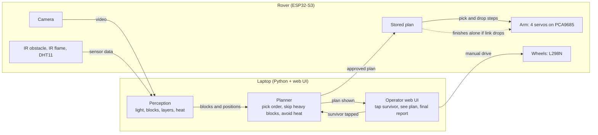
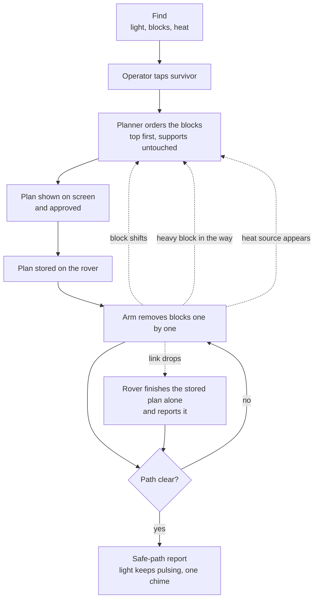
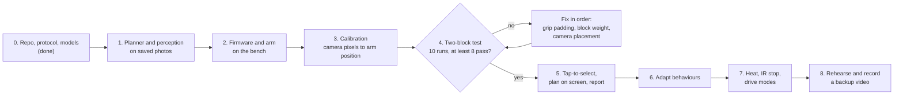

# STILL HERE

A rescue rover that clears a safe path to a trapped survivor (a pulsing light in a dim room).
Built for Innovation Mission 9, "Intelligent Robotics: Autonomous Object Interaction" (48 hours).

## How it works

- **Rover (ESP32-S3)** streams camera video and executes commands: 4-servo arm through a PCA9685, wheels through an L298N, IR and DHT11 sensors.
- **Laptop** finds the light and the blocks, plans which block to remove first, and shows everything in a web UI.
- The two talk over Wi-Fi (phone hotspot, 2.4 GHz) using the messages in `docs/protocol.md`.



## What happens in the demo



## Where it could go: fire and rescue

The blocks are a safe stand-in for a real problem: reaching a trapped person without bringing more of the structure down on them or on the people sent in. After the hackathon we want to grow the same idea (look at the scene, work out what is safe to move, show the plan to a person, move only what they approve) into tools that help fire and rescue crews do more of the risky first look and clearing from a distance, so fewer people have to go in.

- **Stronger arms.** The rover lifts light blocks with hobby servos today. Real debris needs high-torque servos. We would like to talk to servo makers such as [REEFS RC](https://store.hobbyetc.com/parts/view/185207), whose 1400 Smart is a 4S-rated brushless servo, about how high-power servos could make a rescue arm both stronger and safer to use. That also means a bigger power system, see `docs/power.md`.
- **Harsher scenes.** Heat, smoke and dust need better sensing than one flame sensor and a visible-light camera.
- **People first.** We would talk to fire and rescue crews about what they need before building it. A person always approves the plan.

This is an aim, not an agreement: no company has agreed to work with us, and nothing here has been tested on real debris or in a fire. It is a student prototype and must not be used in a real rescue. The full picture is in [docs/roadmap.md](docs/roadmap.md).

## Build order



The full blueprint, including the team diagram and what can be cut, is in [docs/blueprint.md](docs/blueprint.md).

## Project layout

```
still-here/
  README.md                  What it is, the 8/10 gate, team rules, quick start
  .gitignore                 Keeps firmware/secrets.h and laptop/config.toml out of git
  .gitattributes             Unix line endings everywhere, so git stops printing line-ending warnings
  pytest.ini                 Makes pytest from the repo root run only laptop/ and simulation/
  vision.cpp                 C++ camera demo (scale, mm, fire); laptop/vision.py is the full version
  planner.hpp, perception.hpp  OpenCV-free logic for vision.cpp
  test_planner.cpp, test_perception.cpp  Tests for those headers
  CMakeLists.txt             Builds vision.cpp and the two test programs
  simulation/                Phone tilt to Blender digital twin
    phone_bridge.py          Serves the phone page over http and forwards tilt to Blender
    phone_control.html       Phone controller page
    blender_rover.py         Blender scene driven by sim_rover.py
    test_phone_bridge.py     Tests for the bridge
  docs/
    blueprint.md             Diagrams, build order, layout
    protocol.md              Draft message contract between laptop and rover
    power.md                 Two-supply power design, parts, wiring and test plan
    power-supply-improvements.md  What we changed in the power supply and why, with the diagram
    tasks.md                 Per-person checklists for A, B, C, D
    roadmap.md              Where the project could go: fire and rescue, stronger servos, partners
    phone-simulation.md     How the phone and Blender simulation works, for people and LLMs
    trials.csv               Log of the 10 two-block test runs
  laptop/
    models.py                Frozen data types: Block, HeatZone, PlanStep, Plan
    test_models.py           Tests for the data types
    pyproject.toml           Python dependencies (OpenCV, FastAPI, pytest)
    config.example.toml      Rover name, buggy size, block size, marker ids, pulse rate, pass thresholds
    index.html, terms.html, privacy.html, blueprint.html  The project site
    autonomous.html, control.html  The two operator pages (loaded with operator.js, control.js)
    landing.css, landing.js, operator.css  Their style and the landing page script
    planner.py               Top-first pick order, skip heavy blocks, avoid heat
    test_planner.py          Tests for the planner
    route.py                 Which blocks to remove to reach the survivor: cheapest route, heavy blocks and heat avoided
    test_route.py            Tests for the route search
    aruco.py                 ArUco markers on blocks: id, layer, weight; reads config.toml
    scale.py                 Pixels to millimetres, learned from the 40 mm blocks
    scene.py                 Turns picture positions into millimetres and picks plan or route
    stream.py                Reopens the camera stream when it drops out
    test_aruco.py            Tests for the markers and the config
    test_scale.py            Tests for the scale
    test_scene.py            Tests for the scene
    test_stream.py           Tests for the stream
    test_vision_pipeline.py  Whole camera pipeline on made-up pictures
    gyro_map.py              Phone tilt to drive and arm messages
    sim_rover.py             Software rover: same messages as the protocol, no hardware
    test_gyro_map.py         Tests for the phone tilt mapping
    test_sim_rover.py        Tests for the software rover
    vision.py                Colour-blob vision demo (ported from the C++ prototype) feeding the planner
    test_vision.py           Tests for the vision demo on synthetic pictures
    server.py                Operator server: camera with the plan drawn on it, tap, approve, report
    operator_core.py         What the operator sees and may approve; sends the plan to the rover
    scene_watch.py           Compares each picture with the scene a plan was made for: a block moved, vanished or appeared
    test_scene_watch.py, test_operator_replan.py  Tests for the scene check and for stopping and re-planning
    rover_link.py            The server's WebSocket link to the rover: pings every 0.5 s, reconnects by itself
    sim_server.py            The software rover as a WebSocket server, to test the real link with no hardware
    test_rover_link.py, test_sim_server.py  Tests for the link and the software rover server
    manual_core.py           Manual drive and arm commands, with a stop if the page goes quiet
    marker_sheet.py          Makes a printable sheet of ArUco block markers
    api.ts, ui_logic.ts      Page code shared by both pages: server calls and the plain decisions
    operator.ts, control.ts  The autonomous page and the manual control page, in TypeScript
    *.js built from the .ts  What the browser loads, made by build.mjs. Edit the .ts, then run node build.mjs
    build.mjs, tsconfig.json, package.json  Build, type-check and test setup for the pages
    ui_logic.test.ts         Tests for the page decisions, run with node --test
    test_manual.py, test_marker_sheet.py, test_ui_build.py  Tests for manual control, markers and the page build
    plan_message.py          Builds and checks the messages sent to the rover (whole-number plan ids)
    report.py                Fact-first run report, with a summary only from an allowed list, and a chime
    calibrate.py             Camera calibration: picture pixels to millimetres on the table (perspective fit)
    calibration_points.example.json  An example points file for calibrate.py (replace with measured points)
    trial_log.py             Logs the two-block stack test to docs/trials.csv and checks the 8 of 10 gate
    scenario_runner.py       Replays a scenario of protocol messages on the software rover or a real one
    scenario_pick_drop.json  The bundled pick and drop scenario
    test_calibrate.py        Tests for the calibration
    test_trial_log.py        Tests for the trial log
    test_scenario_runner.py  Tests for the scenario runner
    test_plan_message.py     Tests for the messages
    test_report.py           Tests for the report
    origin_guard.py          Only local pages may press the buttons
    test_server.py           Tests for the server
    test_operator.py         Tests for the operator logic
    test_origin_guard.py     Tests for the origin rule
    test_rover_control.py    Tests for the hand-driving console in firmware/
  firmware/
    main.cpp                 Joins Wi-Fi, starts the camera and the video server; the rover loop grows from here
    pins.h                   Pin map for the ESP32-S3 board: camera confirmed, the rest untested
    rover_types.h, rover_json.h  Pose type and the strict message reader (no library, no heap)
    rover_arm.h              Arm lengths, limits and kinematics, the same maths as sim_rover.py
    rover_origin.h           Which web pages may connect, the same rule as origin_guard.py
    rover_core.h             All rover behaviour: plans, link loss, safe stop, ramps, battery guard
    hardware.cpp, hardware.h Real wheels, servos, sensors and battery reading (not bench-tested)
    rover_link.cpp, rover_link.h  WebSocket server on port 81, origin check, mDNS (not bench-tested)
    test_rover_*.cpp         PC tests for the four rover_*.h files
    platformio.ini           ESP32-S3 N16R8 build settings, flat layout
    secrets.example.h        Wi-Fi template for the 2.4 GHz phone hotspot
    rover_sketch.txt         Earlier all-in-one rover sketch, reference only, not built
    cam_probe.txt            Camera sensor probe for the S3 board, paste into the Arduino IDE
    cam_scan.txt             Full camera pin scan, for when the probe finds no known map
    bringup.txt              Bench test for servos, wheels, sensors and battery, paste into the Arduino IDE
    rover_control.py         Console for driving the rover by hand with the protocol messages, through the same link as the server
    camera.h, camera.cpp     GC2145 camera: raw pictures turned into JPEG on the chip
    mjpeg_server.h, .cpp     Video over Wi-Fi: /stream (MJPEG), /capture (one picture)
    link.cpp *               WebSocket server, link-loss handling
    arm.cpp *                PCA9685 servo driver, pick and drop, stored plan
    drive.cpp *              L298N wheels, manual and auto modes, IR stop
    sensors.cpp *            IR obstacle, IR flame and DHT11 readout
```

`*` = planned, not written yet.

## The one thing to do first

The **two-block stack test**: on a two-layer stack the camera finds both blocks, software picks the top one, and the clamp removes it without disturbing the other. Run it 10 times and log each run in `docs/trials.csv`. If fewer than 8 pass, fix grip padding, block weight and camera placement, in that order, before any other feature.

Pass rule: the bottom block moves less than 5 mm and rotates less than 10 degrees (measured from its marker before and after).

## Phone and Blender digital twin

You can rehearse manual control without any rover hardware. The phone sends tilt samples to the laptop, the laptop turns them into the same drive and arm messages the firmware will use, and Blender runs the same rover model (`laptop/sim_rover.py`).

1. Install Blender 4.x and launch the twin from the repo root: `blender --python simulation/blender_rover.py`.
2. In a second terminal, start the bridge: `laptop/.venv/Scripts/python -m uvicorn simulation.phone_bridge:app --host 0.0.0.0 --port 8765`.
3. On the phone, on the same Wi-Fi or hotspot, open `http://<laptop-ip>:8765`, tap **Enable phone controls**, accept motion permission, and hold the phone still so it centres.

The wheels stop on a mode switch, when the phone leaves, and when the phone is quiet for half a second. The page is plain http, so Android Chrome needs a motion setting for that address and iPhones are not expected to work. The full guide is `docs/phone-simulation.md`.

## Team rules

- `docs/protocol.md` is the contract between laptop and firmware. Change it only when all four agree.
- Each person edits their own files (see `docs/tasks.md`). Ask before touching someone else's.
- Never commit `firmware/secrets.h` or `laptop/config.toml`. Copy the `.example` files instead.
- Units: millimetres and degrees everywhere.

## Quick start

Laptop (Python 3.11 or newer):

```bash
cd laptop
python -m venv .venv
.venv/Scripts/activate        # Windows
pip install -e ".[dev]"
pytest
```

Run the operator pages (camera, plan, approve, report) and the manual control page:

```bash
python server.py              # the real rover (still-here.local) and its video; --simulate for no hardware
```

Then open http://127.0.0.1:8000/ for autonomous mode and http://127.0.0.1:8000/control.html for manual control. While the rover works, the server keeps watching the camera. If a block it has not touched moves, vanishes, or a new one appears, it stops the rover, writes the run up as a safe stop, and offers a fresh plan from the new picture. The rover never carries on with a plan nobody has looked at: you approve the new one. The server finds the rover by its name, `still-here.local` (set in `config.toml`, or pass `--rover <name or address>`), and the rover firmware is expected to announce that name on the network. If the rover cannot be reached the pages say so and send nothing. To use the pages from a phone or another laptop on the same Wi-Fi, start it with `python server.py --host 0.0.0.0`. It prints an **access link** with a token in it (and your laptop's Wi-Fi address). Open that link once on the other device: it signs you in and then shows a clean address. This laptop never needs the token, but any other device, and any program other than a browser, is refused without it. The token changes each start (or give one with `--token`). The link is plain http, so use a network you trust, such as your own phone hotspot. With no hardware, use `python server.py clip.avi --simulate`, or run `python sim_server.py` in another window (the software rover as a WebSocket server) and start the server with `--rover 127.0.0.1` to try the whole real-rover path.

First-time setup, in this order:

1. **Settings.** Copy `laptop/config.example.toml` to `laptop/config.toml`. The buggy is officially 200 mm wide and between 450 and 500 mm long: set `[buggy]` to what you measure. The path planner needs a clear corridor of the width plus `clearance_mm` each side, so a wider buggy means more blocks must be moved.
2. **Markers.** `python marker_sheet.py --out markers.png`, print it at 100 percent, check the 50 mm bar with a ruler, cut out the squares and stick them on the side faces the camera sees.
3. **Calibration.** Measure at least 4 marks on the table from the rover (forward and left, in mm), note their pixels, put them in a points file like `calibration_points.example.json`, then `python calibrate.py points.json`. Without it the pages use a flat scale from the block size.
4. **The gate.** Run the two-block stack test 10 times, logging each with `python trial_log.py add ...`, then `python trial_log.py summary`. At least 8 must pass before anything else is built.
5. **Protocol check.** `python scenario_runner.py` replays a pick and drop on the software rover. With the real rover: `python scenario_runner.py --target real --ip <address> --confirm-real` (lift the wheels first).

The pages are written in TypeScript (`laptop/*.ts`) and built to the plain JavaScript the browser loads. After changing a `.ts` file run `node build.mjs` (Node 22.13 or newer, nothing to install); the tests fail if the `.js` is out of date. For type checking, `npm install` then `npm run typecheck`.

Firmware: install PlatformIO, copy `firmware/secrets.example.h` to `firmware/secrets.h`, fill in `firmware/pins.h`, then `pio run -d firmware`.
