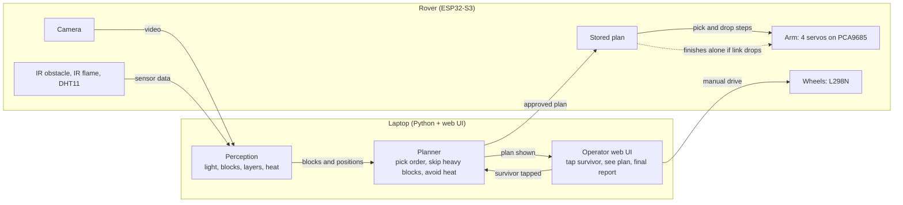
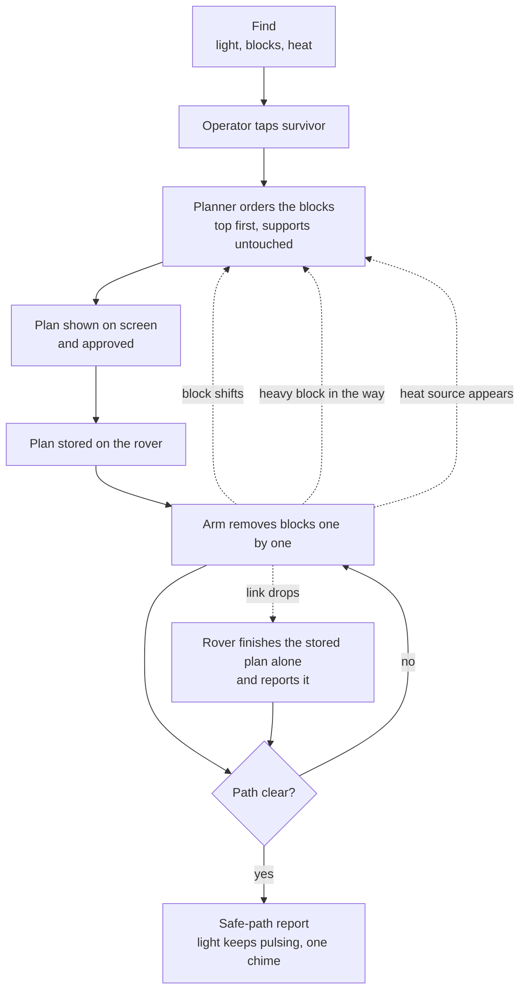
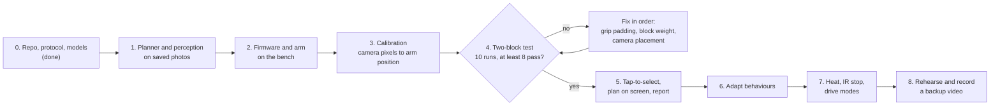

# STILL HERE

A rescue rover that clears a safe path to a trapped survivor (a pulsing light in a dim room).
Built for Innovation Mission 9, "Intelligent Robotics: Autonomous Object Interaction" (48 hours).

## How it works

- **Rover (ESP32-S3)** streams camera video and executes commands: 4-servo arm through a PCA9685, wheels through an L298N, IR and DHT11 sensors.
- **Laptop** finds the light and the blocks, plans which block to remove first, and shows everything in a web UI.
- The two talk over Wi-Fi (phone hotspot, 2.4 GHz) using the messages in `docs/protocol.md`.



## What happens in the demo



## Where it could go: fire and rescue

The blocks are a safe stand-in for a real problem: reaching a trapped person without bringing more of the structure down on them or on the people sent in. After the hackathon we want to grow the same idea (look at the scene, work out what is safe to move, show the plan to a person, move only what they approve) into tools that help fire and rescue crews do more of the risky first look and clearing from a distance, so fewer people have to go in.

- **Stronger arms.** The rover lifts light blocks with hobby servos today. Real debris needs high-torque servos. We would like to talk to servo makers such as [REEFS RC](https://store.hobbyetc.com/parts/view/185207), whose 1400 Smart is a 4S-rated brushless servo, about how high-power servos could make a rescue arm both stronger and safer to use. That also means a bigger power system, see `docs/power.md`.
- **Harsher scenes.** Heat, smoke and dust need better sensing than one flame sensor and a visible-light camera.
- **People first.** We would talk to fire and rescue crews about what they need before building it. A person always approves the plan.

This is an aim, not an agreement: no company has agreed to work with us, and nothing here has been tested on real debris or in a fire. It is a student prototype and must not be used in a real rescue. The full picture is in [docs/roadmap.md](docs/roadmap.md).

## Build order



The full blueprint, including the team diagram and what can be cut, is in [docs/blueprint.md](docs/blueprint.md).

## Project layout

```
still-here/
  README.md                  What it is, how to run it, team rules
  CMakeLists.txt             Builds the C++ prototype and the firmware's PC tests (run them with ctest)
  pytest.ini                 Running pytest from here tests laptop/tests and simulation/ only
  run_rover.bat              Windows shortcut that starts the operator server for the real rover
  .gitignore, .gitattributes Keep secrets, caches and models out of git; Unix line endings everywhere

  docs/                      Everything written down
    blueprint.md             Diagrams, build order, this layout
    protocol.md              The message contract between laptop and rover
    tasks.md                 Per-person checklists and what is still open
    mission-9-compliance.md  The challenge brief, line by line, with proof and remaining gaps
    production-readiness.md  What was hardened, and what must be decided before real use
    autonomy-demo.md         The autonomous, learning demo in the Blender twin
    demo-runbook.md          Demo with a real webcam and the software rover
    demo-assumptions.md      The approximate hardware profile the demo uses
    survivor-detection.md    Finding a person with a pretrained detector
    bench-and-integration-checklist.md  Safe, ordered bring-up of the real board
    power.md, power-supply-improvements.md/.svg  The two-supply power design
    phone-simulation.md      Phone tilt to Blender twin
    roadmap.md               Where the project could go: fire and rescue
    trials.csv               Log of the 10 two-block test runs

  laptop/                    The laptop software (Python 3.11 or newer)
    pyproject.toml           Dependencies and the list of installed modules
    config.example.toml, calibration_points.example.json, scenario_pick_drop.json  Examples to copy
    tests/                   Every laptop test (pytest)
    web/                     The pages: HTML, CSS, TypeScript, and the JavaScript built from it
      *.ts                   Edit these, then run node build.mjs (in this folder)
      build.mjs, tsconfig.json, package.json, ui_logic.test.ts  Build, type-check and test setup
    Perception
      vision.py              Finds blocks, fire and the survivor's pulsing light, feeds the planner
      aruco.py               Block markers: id, layer, weight; reads config.toml
      scale.py, calibrate.py, scene.py  Pixels to millimetres, calibration, the scene in millimetres
      scene_watch.py, grip_watch.py     Notice a block that moved, vanished or was not really lifted
      stream.py, serial_camera.py       Camera sources that reconnect: network stream, USB cable
      person_detector.py     Pretrained YOLOX-S person finder (model file not in git)
      marker_sheet.py        Makes a printable sheet of block markers
    Planning
      models.py              Frozen data types: Block, HeatZone, PlanStep, Plan
      planner.py, route.py   Top-first pick order; the cheapest safe route to the survivor
      experience.py          Learns extra corridor clearance from past runs
    Operator and server
      server.py              Operator server: camera with the plan drawn on it, approve, stop, report
      operator_core.py       What the operator sees and may approve; sends the plan to the rover
      autopilot.py           Autonomous mode for the Blender demo (approves its own plans, learns)
      manual_core.py         Manual drive and arm commands, with a stop if the page goes quiet
      plan_message.py        Builds and checks the messages sent to the rover
      rover_link.py          WebSocket link to the rover: pings, reconnects by itself
      origin_guard.py        Only local pages and local host names may reach the server
      report.py              Fact-first run report with a fixed set of allowed summaries
      trial_log.py, scenario_runner.py  The 8 of 10 gate log; replay a scenario on a software or real rover
    Simulation
      sim_rover.py, sim_server.py       The software rover, and the same as a WebSocket server
      demo_world.py          The demo scene shared by Blender and the tests
      blender_link.py, blender_camera.py, snapshot_client.py, snapshot_protocol.py  Talking to the Blender twin
      gyro_map.py            Phone tilt to drive and arm messages

  firmware/                  The rover's code (ESP32); flat layout, PlatformIO builds it
    main.cpp                 Joins Wi-Fi, starts the camera, the video server and the control task
    pins.h, secrets.example.h  Pin map; Wi-Fi template (copy to secrets.h)
    rover_core.h             All rover behaviour: plans, link loss, safe stop, ramps, battery guard
    rover_arm.h, rover_json.h, rover_origin.h, rover_types.h  Arm maths, strict message reader, origin rule, types
    hardware.cpp/.h          Real wheels, servos, sensors and battery reading (not bench-tested)
    rover_link.cpp/.h        WebSocket server on port 81, origin check, mDNS (not bench-tested)
    camera.cpp/.h, mjpeg_server.cpp/.h  GC2145 camera, video over Wi-Fi
    rover_arm_ap.cpp         The Manual tab's firmware for the classic ESP32 arm board (-e rover_arm)
    diag_main.cpp            Boot report only, to find out why the real firmware does not start (-e diag)
    rover_control.py         Console for driving the rover by hand with the protocol messages
    test_rover_*.cpp         PC tests for the rover_*.h files
    platformio.ini           Build settings for the three environments
    sketches/                Arduino IDE sketches (bring-up, camera probe and scan), not built by PlatformIO

  simulation/                Blender twin, phone bridge, demo recorder
    blender_rover.py         The Blender scene driven by the software rover
    phone_bridge.py, phone_control.html  Phone tilt to Blender
    record_demo.py, survivor_check.py    Record the demo video; find the survivor in a picture
    test_*.py                Tests for those

  prototype-cpp/             The first C++ camera demo and its tests (superseded by laptop/vision.py)
  archive/                   Old files kept for reference, not part of any build
```

Note: the two firmwares drive different arms (4 servos on the ESP32-S3 in `main.cpp`, 5 on the classic ESP32 in `rover_arm_ap.cpp`). Settle which one is the final robot, see [docs/production-readiness.md](docs/production-readiness.md).

## The one thing to do first

The **two-block stack test**: on a two-layer stack the camera finds both blocks, software picks the top one, and the clamp removes it without disturbing the other. Run it 10 times and log each run in `docs/trials.csv`. If fewer than 8 pass, fix grip padding, block weight and camera placement, in that order, before any other feature.

Pass rule: the bottom block moves less than 5 mm and rotates less than 10 degrees (measured from its marker before and after).

For the current time-boxed demo, this is a deferred validation gate rather than a completed
claim. The explicit approximate hardware profile and live-demo limits are in
[docs/demo-assumptions.md](docs/demo-assumptions.md).

## Meeting the brief, and using it for real

- [docs/mission-9-compliance.md](docs/mission-9-compliance.md) checks the project against the Innovation Mission 9 brief and lists the gaps that remain.
- [docs/production-readiness.md](docs/production-readiness.md) lists what was hardened and what must be decided before real use.

## Real-board integration

Use [docs/bench-and-integration-checklist.md](docs/bench-and-integration-checklist.md) for the safe,
ordered board bring-up: PCA9685 scan, one-joint-at-a-time servo checks, wheels, sensors, battery,
Wi-Fi, laptop link, calibration, then the 8/10 two-block gate. It deliberately keeps unmeasured
servo directions, sensor polarity, wheel track, and top speed out of production constants.

## Phone and Blender digital twin

You can rehearse manual control without any rover hardware. The phone sends tilt samples to the laptop, the laptop turns them into the same drive and arm messages the firmware will use, and Blender runs the same rover model (`laptop/sim_rover.py`).

1. Install Blender 4.x and launch the twin from the repo root: `blender --python simulation/blender_rover.py`.
2. In a second terminal, start the bridge: `laptop/.venv/Scripts/python -m uvicorn simulation.phone_bridge:app --host 0.0.0.0 --port 8765`.
3. On the phone, on the same Wi-Fi or hotspot, open `http://<laptop-ip>:8765`, tap **Enable phone controls**, accept motion permission, and hold the phone still so it centres.

The wheels stop on a mode switch, when the phone leaves, and when the phone is quiet for half a second. The page is plain http, so Android Chrome needs a motion setting for that address and iPhones are not expected to work. The full guide is `docs/phone-simulation.md`.

## Team rules

- `docs/protocol.md` is the contract between laptop and firmware. Change it only when all four agree.
- Each person edits their own files (see `docs/tasks.md`). Ask before touching someone else's.
- Never commit `firmware/secrets.h` or `laptop/config.toml`. Copy the `.example` files instead.
- Units: millimetres and degrees everywhere.

## Quick start

Laptop (Python 3.11 or newer):

```bash
cd laptop
python -m venv .venv
.venv/Scripts/activate        # Windows
pip install -e ".[dev]"
pytest
```

Run the operator pages (camera, plan, approve, report) and the manual control page:

```bash
python server.py              # the real rover (still-here.local) and its video; --simulate for no hardware
```

Then open http://127.0.0.1:8000/ for autonomous mode and http://127.0.0.1:8000/control.html for manual control. While the rover works, the server keeps watching the camera. If a block it has not touched moves, vanishes, or a new one appears, it stops the rover, writes the run up as a safe stop, and offers a fresh plan from the new picture. The rover never carries on with a plan nobody has looked at: you approve the new one. The server finds the rover by its name, `still-here.local` (set in `config.toml`, or pass `--rover <name or address>`), and the rover firmware is expected to announce that name on the network. If the rover cannot be reached the pages say so and send nothing. To use the pages from a phone or another laptop on the same Wi-Fi, start it with `python server.py --host 0.0.0.0`. It prints an **access link** with a token in it (and your laptop's Wi-Fi address). Open that link once on the other device: it signs you in and then shows a clean address. This laptop never needs the token, but any other device, and any program other than a browser, is refused without it. The token changes each start (or give one with `--token`). The link is plain http, so use a network you trust, such as your own phone hotspot. To watch the rover learn, run the Blender twin and then `python server.py --blender 8766 --auto --episodes 3` (see [docs/autonomy-demo.md](docs/autonomy-demo.md)): the first run brushes a block the planner thought was safe, the laptop widens the corridor, and the second run removes that block too. With no hardware, use `python server.py clip.avi --simulate`, or run `python sim_server.py` in another window (the software rover as a WebSocket server) and start the server with `--rover 127.0.0.1` to try the whole real-rover path.

First-time setup, in this order:

1. **Settings.** Copy `laptop/config.example.toml` to `laptop/config.toml`. The buggy is officially 200 mm wide and between 450 and 500 mm long: set `[buggy]` to what you measure. The path planner needs a clear corridor of the width plus `clearance_mm` each side, so a wider buggy means more blocks must be moved.
2. **Markers.** `python marker_sheet.py --out markers.png`, print it at 100 percent, check the 50 mm bar with a ruler, cut out the squares and stick them on the side faces the camera sees.
3. **Calibration.** Measure at least 4 marks on the table from the rover (forward and left, in mm), note their pixels, put them in a points file like `calibration_points.example.json`, then `python calibrate.py points.json`. Without it the pages use a flat scale from the block size.
4. **The gate.** Run the two-block stack test 10 times, logging each with `python trial_log.py add ...`, then `python trial_log.py summary`. At least 8 must pass before anything else is built.
5. **Protocol check.** `python scenario_runner.py` replays a pick and drop on the software rover. With the real rover: `python scenario_runner.py --target real --ip <address> --confirm-real` (lift the wheels first).

The pages are written in TypeScript (`laptop/web/*.ts`) and built to the plain JavaScript the browser loads. After changing a `.ts` file run `node build.mjs` in `laptop/web` (Node 22.13 or newer, nothing to install); the tests fail if the `.js` is out of date. For type checking, `npm install` then `npm run typecheck`, both in `laptop/web`.

Firmware: install PlatformIO, copy `firmware/secrets.example.h` to `firmware/secrets.h`, fill in `firmware/pins.h`, then `pio run -d firmware`.
