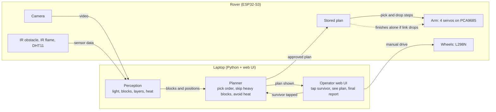
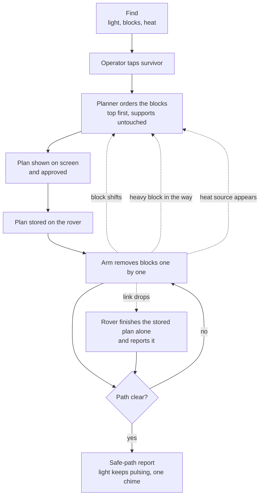
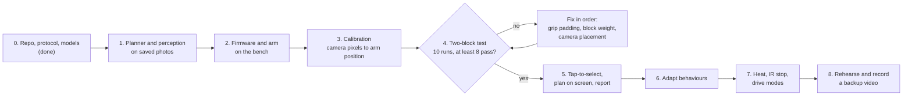
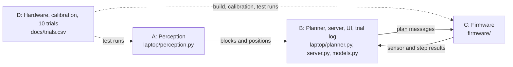

# STILL HERE: project blueprint

One page. For detail see `protocol.md` (messages) and `tasks.md` (who does what).

## 1. Goal

A rover finds a trapped survivor (a pulsing light in a dim room), works out which blocks are in the way, and removes them with its arm without knocking over the blocks that hold others up. When the path is clear it shows a safe-path report.

## 2. How the system works

The rover is the body (sees and moves). The laptop is the brain (thinks and shows). The rover keeps a copy of the approved plan, so it can finish alone if the link drops.



## 3. What happens in the demo



Dotted lines are the adapt behaviours: re-plan when a block shifts, leave a heavy block and go around, stay clear of heat, and finish alone if the link drops.

## 4. Build order



Pass rule for each run: the bottom block moves under 5 mm and rotates under 10 degrees. Nothing from step 5 on starts until the gate passes.

| Step | Done when |
|---|---|
| 1 | Tests pass on saved photos |
| 2 | Arm picks one block on command |
| 3 | Arm reaches a marker the camera can see |
| 4 | At least 8 of 10 runs pass |
| 5 | Operator can run it end to end |
| 6 | Each behaviour shown once |
| 7 | Only if time allows |
| 8 | Last 6 hours |

## 5. People



## 6. Project layout

```
still-here/
  README.md                  What it is, how to run it, team rules
  CMakeLists.txt             Builds the C++ prototype and the firmware's PC tests (run them with ctest)
  pytest.ini                 Running pytest from here tests laptop/tests and simulation/ only
  run_rover.bat              Windows shortcut that starts the operator server for the real rover
  .gitignore, .gitattributes Keep secrets, caches and models out of git; Unix line endings everywhere

  docs/                      Everything written down
    blueprint.md             Diagrams, build order, this layout
    protocol.md              The message contract between laptop and rover
    tasks.md                 Per-person checklists and what is still open
    mission-9-compliance.md  The challenge brief, line by line, with proof and remaining gaps
    production-readiness.md  What was hardened, and what must be decided before real use
    autonomy-demo.md         The autonomous, learning demo in the Blender twin
    demo-runbook.md          Demo with a real webcam and the software rover
    demo-assumptions.md      The approximate hardware profile the demo uses
    survivor-detection.md    Finding a person with a pretrained detector
    bench-and-integration-checklist.md  Safe, ordered bring-up of the real board
    power.md, power-supply-improvements.md/.svg  The two-supply power design
    phone-simulation.md      Phone tilt to Blender twin
    roadmap.md               Where the project could go: fire and rescue
    trials.csv               Log of the 10 two-block test runs

  laptop/                    The laptop software (Python 3.11 or newer)
    pyproject.toml           Dependencies and the list of installed modules
    config.example.toml, calibration_points.example.json, scenario_pick_drop.json  Examples to copy
    tests/                   Every laptop test (pytest)
    web/                     The pages: HTML, CSS, TypeScript, and the JavaScript built from it
      *.ts                   Edit these, then run node build.mjs (in this folder)
      build.mjs, tsconfig.json, package.json, ui_logic.test.ts  Build, type-check and test setup
    Perception
      vision.py              Finds blocks, fire and the survivor's pulsing light, feeds the planner
      aruco.py               Block markers: id, layer, weight; reads config.toml
      scale.py, calibrate.py, scene.py  Pixels to millimetres, calibration, the scene in millimetres
      scene_watch.py, grip_watch.py     Notice a block that moved, vanished or was not really lifted
      stream.py, serial_camera.py       Camera sources that reconnect: network stream, USB cable
      person_detector.py     Pretrained YOLOX-S person finder (model file not in git)
      marker_sheet.py        Makes a printable sheet of block markers
    Planning
      models.py              Frozen data types: Block, HeatZone, PlanStep, Plan
      planner.py, route.py   Top-first pick order; the cheapest safe route to the survivor
      experience.py          Learns extra corridor clearance from past runs
    Operator and server
      server.py              Operator server: camera with the plan drawn on it, approve, stop, report
      operator_core.py       What the operator sees and may approve; sends the plan to the rover
      autopilot.py           Autonomous mode for the Blender demo (approves its own plans, learns)
      manual_core.py         Manual drive and arm commands, with a stop if the page goes quiet
      plan_message.py        Builds and checks the messages sent to the rover
      rover_link.py          WebSocket link to the rover: pings, reconnects by itself
      origin_guard.py        Only local pages and local host names may reach the server
      report.py              Fact-first run report with a fixed set of allowed summaries
      trial_log.py, scenario_runner.py  The 8 of 10 gate log; replay a scenario on a software or real rover
    Simulation
      sim_rover.py, sim_server.py       The software rover, and the same as a WebSocket server
      demo_world.py          The demo scene shared by Blender and the tests
      blender_link.py, blender_camera.py, snapshot_client.py, snapshot_protocol.py  Talking to the Blender twin
      gyro_map.py            Phone tilt to drive and arm messages

  firmware/                  The rover's code (ESP32); flat layout, PlatformIO builds it
    main.cpp                 Joins Wi-Fi, starts the camera, the video server and the control task
    pins.h, secrets.example.h  Pin map; Wi-Fi template (copy to secrets.h)
    rover_core.h             All rover behaviour: plans, link loss, safe stop, ramps, battery guard
    rover_arm.h, rover_json.h, rover_origin.h, rover_types.h  Arm maths, strict message reader, origin rule, types
    hardware.cpp/.h          Real wheels, servos, sensors and battery reading (not bench-tested)
    rover_link.cpp/.h        WebSocket server on port 81, origin check, mDNS (not bench-tested)
    camera.cpp/.h, mjpeg_server.cpp/.h  GC2145 camera, video over Wi-Fi
    rover_arm_ap.cpp         The Manual tab's firmware for the classic ESP32 arm board (-e rover_arm)
    diag_main.cpp            Boot report only, to find out why the real firmware does not start (-e diag)
    rover_control.py         Console for driving the rover by hand with the protocol messages
    test_rover_*.cpp         PC tests for the rover_*.h files
    platformio.ini           Build settings for the three environments
    sketches/                Arduino IDE sketches (bring-up, camera probe and scan), not built by PlatformIO

  simulation/                Blender twin, phone bridge, demo recorder
    blender_rover.py         The Blender scene driven by the software rover
    phone_bridge.py, phone_control.html  Phone tilt to Blender
    record_demo.py, survivor_check.py    Record the demo video; find the survivor in a picture
    test_*.py                Tests for those

  prototype-cpp/             The first C++ camera demo and its tests (superseded by laptop/vision.py)
  archive/                   Old files kept for reference, not part of any build
```

`*` = planned, not written yet. Each file has one owner (see `tasks.md`), so two people rarely edit the same file.

## 7. What can be cut

First to go: heat avoidance, then drive modes, then link-drop finish. Never cut: the two-block test, the plan shown on screen, and the final report.

## 8. Beyond the hackathon

We want to take the same idea (see the scene, decide what is safe to move, show the plan, move only what a person approves) into fire and rescue work, and to talk to servo makers such as REEFS RC about high-power servos for a stronger arm. That needs a bigger power system and real trials with rescue crews. It is an aim, not an agreement, and none of it is tested yet. See `roadmap.md`.
