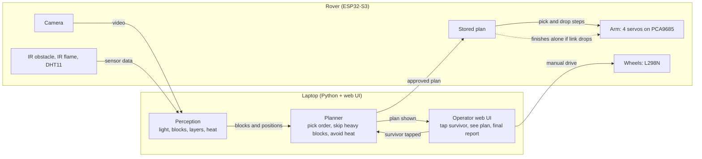
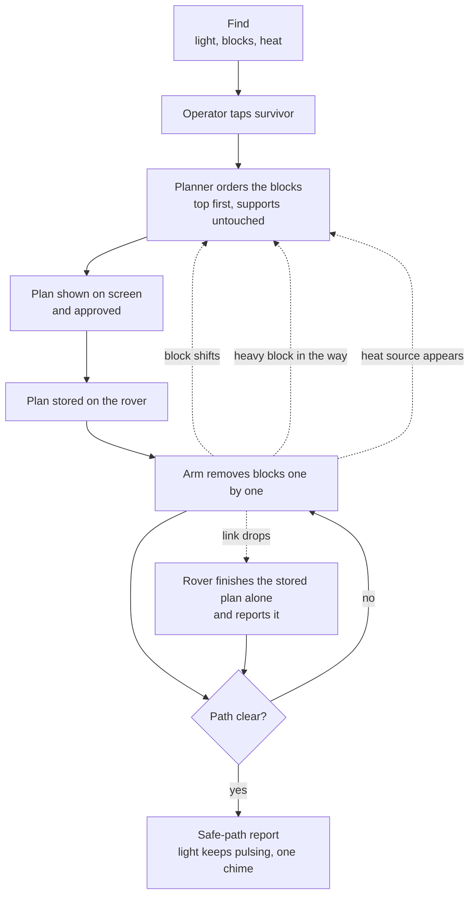
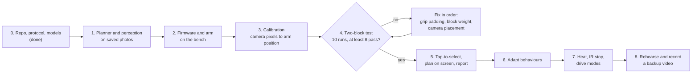
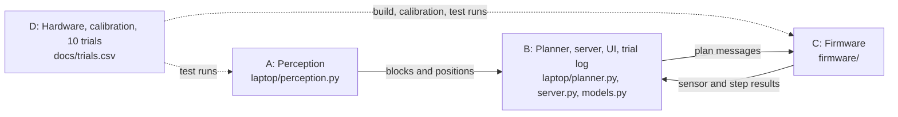

# STILL HERE: project blueprint

One page. For detail see `protocol.md` (messages) and `tasks.md` (who does what).

## 1. Goal

A rover finds a trapped survivor (a pulsing light in a dim room), works out which blocks are in the way, and removes them with its arm without knocking over the blocks that hold others up. When the path is clear it shows a safe-path report.

## 2. How the system works

The rover is the body (sees and moves). The laptop is the brain (thinks and shows). The rover keeps a copy of the approved plan, so it can finish alone if the link drops.



## 3. What happens in the demo



Dotted lines are the adapt behaviours: re-plan when a block shifts, leave a heavy block and go around, stay clear of heat, and finish alone if the link drops.

## 4. Build order



Pass rule for each run: the bottom block moves under 5 mm and rotates under 10 degrees. Nothing from step 5 on starts until the gate passes.

| Step | Done when |
|---|---|
| 1 | Tests pass on saved photos |
| 2 | Arm picks one block on command |
| 3 | Arm reaches a marker the camera can see |
| 4 | At least 8 of 10 runs pass |
| 5 | Operator can run it end to end |
| 6 | Each behaviour shown once |
| 7 | Only if time allows |
| 8 | Last 6 hours |

## 5. People



## 6. Project layout

```
still-here/
  README.md                  What it is, the 8/10 gate, team rules, quick start
  .gitignore                 Keeps firmware/secrets.h and laptop/config.toml out of git
  docs/
    blueprint.md             This page: diagrams, build order, layout
    protocol.md              Draft message contract between laptop and rover
    tasks.md                 Per-person checklists for A, B, C, D
    trials.csv               Log of the 10 two-block test runs
  laptop/
    models.py                Frozen data types: Block, HeatZone, PlanStep, Plan
    test_models.py           Tests for the data types
    pyproject.toml           Python dependencies (OpenCV, FastAPI, pytest)
    config.example.toml      Rover IP, block size, pulse rate, pass thresholds
    perception.py *          Pulsing light, ArUco blocks, layer order, heat
    planner.py               Top-first pick order, skip heavy blocks, avoid heat
    test_planner.py          Tests for the planner
    route.py                 Which blocks to remove to reach the survivor: cheapest route, heavy blocks and heat avoided
    test_route.py            Tests for the route search
    scale.py                 Pixels to millimetres, learned from the 40 mm blocks
    scene.py                 Turns picture positions into millimetres and picks plan or route
    stream.py                Reopens the camera stream when it drops out
    test_scale.py            Tests for the scale
    test_scene.py            Tests for the scene
    test_stream.py           Tests for the stream
    test_vision_pipeline.py  Whole camera pipeline on made-up pictures
    vision.py                Colour-blob vision demo (ported from the C++ prototype) feeding the planner
    test_vision.py           Tests for the vision demo on synthetic pictures
    server.py *              FastAPI and WebSocket link to the rover, serves the UI
    calibrate.py *           Camera pixels to arm position, one command to re-run
    trial_log.py *           Appends runs to trials.csv, applies the 5 mm / 10 degree rule
    ui.html, ui.ts *         Operator page: tap survivor, see plan, final report
  firmware/
    main.cpp                 Boot stub, grows into the rover loop
    pins.h                   Pin map, every pin -1 until the hardware design is read
    platformio.ini           ESP32-S3 N16R8 build settings, flat layout
    secrets.example.h        Wi-Fi template for the 2.4 GHz phone hotspot
    link.cpp *               Camera stream and WebSocket server, link-loss handling
    arm.cpp *                PCA9685 servo driver, pick and drop, stored plan
    drive.cpp *              L298N wheels, manual and auto modes, IR stop
    sensors.cpp *            IR obstacle, IR flame and DHT11 readout
```

`*` = planned, not written yet. Each file has one owner (see `tasks.md`), so two people rarely edit the same file.

## 7. What can be cut

First to go: heat avoidance, then drive modes, then link-drop finish. Never cut: the two-block test, the plan shown on screen, and the final report.
