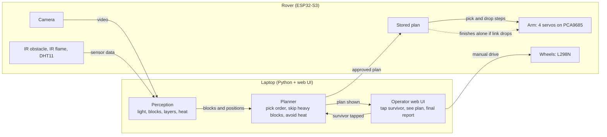
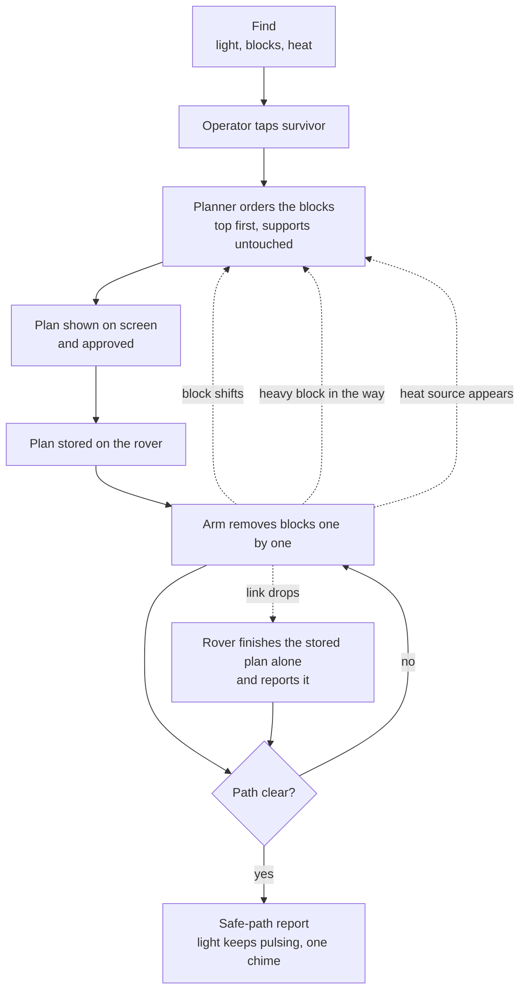
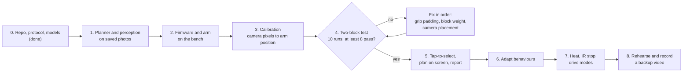
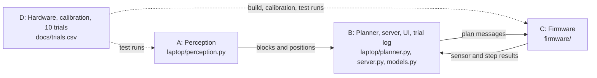

# STILL HERE: project blueprint

One page. For detail see `protocol.md` (messages) and `tasks.md` (who does what).

## 1. Goal

A rover finds a trapped survivor (a pulsing light in a dim room), works out which blocks are in the way, and removes them with its arm without knocking over the blocks that hold others up. When the path is clear it shows a safe-path report.

## 2. How the system works

The rover is the body (sees and moves). The laptop is the brain (thinks and shows). The rover keeps a copy of the approved plan, so it can finish alone if the link drops.



## 3. What happens in the demo



Dotted lines are the adapt behaviours: re-plan when a block shifts, leave a heavy block and go around, stay clear of heat, and finish alone if the link drops.

## 4. Build order



Pass rule for each run: the bottom block moves under 5 mm and rotates under 10 degrees. Nothing from step 5 on starts until the gate passes.

| Step | Done when |
|---|---|
| 1 | Tests pass on saved photos |
| 2 | Arm picks one block on command |
| 3 | Arm reaches a marker the camera can see |
| 4 | At least 8 of 10 runs pass |
| 5 | Operator can run it end to end |
| 6 | Each behaviour shown once |
| 7 | Only if time allows |
| 8 | Last 6 hours |

## 5. People



## 6. Project layout

```
still-here/
  README.md                  What it is, the 8/10 gate, team rules, quick start
  .gitignore                 Keeps firmware/secrets.h and laptop/config.toml out of git
  vision.cpp                 C++ camera demo (scale, mm, fire); laptop/vision.py is the full version
  planner.hpp, perception.hpp  OpenCV-free logic for vision.cpp
  test_planner.cpp, test_perception.cpp  Tests for those headers
  CMakeLists.txt             Builds vision.cpp and the two test programs
  simulation/                Phone tilt to Blender digital twin
    phone_bridge.py          Serves the phone page over http and forwards tilt to Blender
    phone_control.html       Phone controller page
    blender_rover.py         Blender scene driven by sim_rover.py
    test_phone_bridge.py     Tests for the bridge
  docs/
    blueprint.md             This page: diagrams, build order, layout
    protocol.md              Draft message contract between laptop and rover
    tasks.md                 Per-person checklists for A, B, C, D
    roadmap.md              Where the project could go: fire and rescue, stronger servos, partners
    phone-simulation.md     How the phone and Blender simulation works, for people and LLMs
    trials.csv               Log of the 10 two-block test runs
  laptop/
    models.py                Frozen data types: Block, HeatZone, PlanStep, Plan
    test_models.py           Tests for the data types
    pyproject.toml           Python dependencies (OpenCV, FastAPI, pytest)
    config.example.toml      Rover IP, block size, pulse rate, pass thresholds
    perception.py *          Pulsing light, ArUco blocks, layer order, heat
    planner.py               Top-first pick order, skip heavy blocks, avoid heat
    test_planner.py          Tests for the planner
    route.py                 Which blocks to remove to reach the survivor: cheapest route, heavy blocks and heat avoided
    test_route.py            Tests for the route search
    aruco.py                 ArUco markers on blocks: id, layer, weight; reads config.toml
    scale.py                 Pixels to millimetres, learned from the 40 mm blocks
    scene.py                 Turns picture positions into millimetres and picks plan or route
    stream.py                Reopens the camera stream when it drops out
    test_aruco.py            Tests for the markers and the config
    test_scale.py            Tests for the scale
    test_scene.py            Tests for the scene
    test_stream.py           Tests for the stream
    test_vision_pipeline.py  Whole camera pipeline on made-up pictures
    gyro_map.py              Phone tilt to drive and arm messages
    sim_rover.py             Software rover: same messages as the protocol, no hardware
    test_gyro_map.py         Tests for the phone tilt mapping
    test_sim_rover.py        Tests for the software rover
    vision.py                Colour-blob vision demo (ported from the C++ prototype) feeding the planner
    test_vision.py           Tests for the vision demo on synthetic pictures
    server.py                Operator server: camera with the plan drawn on it, tap, approve, report
    operator_core.py         What the operator sees and may approve; sends the plan to the rover
    manual_core.py           Manual drive and arm commands, with a stop if the page goes quiet
    marker_sheet.py          Makes a printable sheet of ArUco block markers
    api.ts, ui_logic.ts      Page code shared by both pages: server calls and the plain decisions
    operator.ts, control.ts  The autonomous page and the manual control page, in TypeScript
    *.js built from the .ts  What the browser loads, made by build.mjs. Edit the .ts, then run node build.mjs
    build.mjs, tsconfig.json, package.json  Build, type-check and test setup for the pages
    ui_logic.test.ts         Tests for the page decisions, run with node --test
    test_manual.py, test_marker_sheet.py, test_ui_build.py  Tests for manual control, markers and the page build
    plan_message.py          Builds and checks the messages sent to the rover (whole-number plan ids)
    report.py                Fact-first run report, with a summary only from an allowed list, and a chime
    run.py                   Console run of the same protocol steps against a rover link you supply
    calibrate.py             Camera calibration: picture pixels to millimetres on the table (perspective fit)
    calibration_points.example.json  An example points file for calibrate.py (replace with measured points)
    trial_log.py             Logs the two-block stack test to docs/trials.csv and checks the 8 of 10 gate
    scenario_runner.py       Replays a scenario of protocol messages on the software rover or a real one
    scenario_pick_drop.json  The bundled pick and drop scenario
    test_calibrate.py        Tests for the calibration
    test_trial_log.py        Tests for the trial log
    test_scenario_runner.py  Tests for the scenario runner
    test_plan_message.py     Tests for the messages
    test_report.py           Tests for the report
    test_run.py              Tests for the console run
    origin_guard.py          Only local pages may press the buttons
    test_server.py           Tests for the server
    test_operator.py         Tests for the operator logic
    test_origin_guard.py     Tests for the origin rule
  firmware/
    main.cpp                 Boot stub, grows into the rover loop
    pins.h                   Pin map for the ESP32-S3 board: camera confirmed, the rest untested
    platformio.ini           ESP32-S3 N16R8 build settings, flat layout
    secrets.example.h        Wi-Fi template for the 2.4 GHz phone hotspot
    rover_sketch.txt         Earlier all-in-one rover sketch, reference only, not built
    cam_probe.txt            Camera sensor probe for the S3 board, paste into the Arduino IDE
    cam_scan.txt             Full camera pin scan, for when the probe finds no known map
    bringup.txt              Bench test for servos, wheels, sensors and battery, paste into the Arduino IDE
    esp32cam_stream.txt      Old AI-Thinker ESP32-CAM streaming sketch, reference only, not built
    rover_control.py         Menu client for the rover (uses the older command set, see docs/protocol.md)
    camera.h, camera.cpp     GC2145 camera: raw pictures turned into JPEG on the chip
    mjpeg_server.h, .cpp     Video over Wi-Fi: /stream (MJPEG), /capture (one picture)
    link.cpp *               WebSocket server, link-loss handling
    arm.cpp *                PCA9685 servo driver, pick and drop, stored plan
    drive.cpp *              L298N wheels, manual and auto modes, IR stop
    sensors.cpp *            IR obstacle, IR flame and DHT11 readout
```

`*` = planned, not written yet. Each file has one owner (see `tasks.md`), so two people rarely edit the same file.

## 7. What can be cut

First to go: heat avoidance, then drive modes, then link-drop finish. Never cut: the two-block test, the plan shown on screen, and the final report.

## 8. Beyond the hackathon

We want to take the same idea (see the scene, decide what is safe to move, show the plan, move only what a person approves) into fire and rescue work, and to talk to servo makers such as REEFS RC about high-power servos for a stronger arm. That needs a bigger power system and real trials with rescue crews. It is an aim, not an agreement, and none of it is tested yet. See `roadmap.md`.
