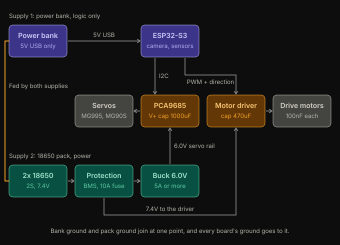

# Power supply improvements

**What we did:** split the rover's power into two supplies. The power bank now runs only the ESP32-S3 (logic), and a protected 2S 18650 pack runs the servos and drive motors through a 6.0V buck converter and the motor driver, with both grounds joined at one point.

**Why:** our mentor pointed out that one power bank feeding a buck converter shared by the DC motors causes large voltage fluctuations. Motor starts and servo stalls pull sharp current spikes, the bank's protection reacts, and the ESP32 browns out and resets mid-run. Separating the supplies keeps those spikes away from the electronics, and it is the cheapest change that keeps the two-block test reliable.

Purple is supply 1 (power bank, logic only). Teal is supply 2 (the 18650 pack). Amber parts take signals from supply 1 and power from supply 2. Gray parts are the loads.

The full parts list, capacitor values, load budget, firmware changes and test plan are in [power.md](power.md).
