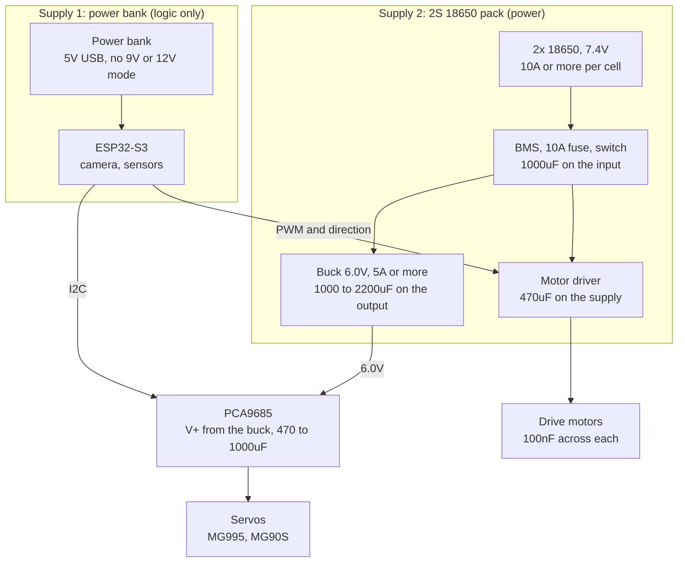

# Power supply design

Owner: Person D (hardware). Status: design, not built yet. Numbers marked "assumed" come from typical datasheets and must be checked against the real parts.

A short summary with a picture of the design is in [power-supply-improvements.md](power-supply-improvements.md).

## The problem

With one power bank feeding a buck converter that also runs the DC motors, the supply voltage fluctuates. The mentor's comment is right, for four reasons:

- A motor starting or reversing pulls several times its running current for a few milliseconds. A power bank's protection circuit reacts to that sag by cutting the output for an instant.
- Power banks switch off when the load is small, for example when the motors are idle.
- A buck converter only steps voltage down. It cannot hide a source that dips, and cheap modules react slowly to load changes.
- Brushed motors are electrically noisy, and they share a rail with the ESP32.

When the ESP32's 5V dips, it browns out and reboots mid-run. That would end a two-block test.

## The fix: two supplies, one ground

Do not ask one source to do both jobs. The power bank runs only the low-power electronics. A 2S 18650 pack runs everything that moves.

Rules that make it work:

- **One shared ground.** Join the bank's ground and the pack's ground at a single point. Every board's ground goes to that point. Without it the signals have no reference.
- **No power crosses between the supplies.** Only ground and signals do.
- **The power bank stays on 5V.** Do not use a 9V or 12V (PD or QC) mode, and do not use a PD trigger board. A mode renegotiation during a spike resets the ESP32.

## Load budget

Assumed values. The servo mix is assumed to be 4 servos, two MG995 and two MG90S, and the wheels two yellow TT motors.

| Load | Supply | Typical | Worst case (stall) |
|---|---|---|---|
| ESP32-S3 with camera and Wi-Fi | power bank, 5V | about 0.4A | about 0.6A |
| PCA9685 logic and sensors | power bank, 5V | under 0.1A | under 0.1A |
| MG995 servo, each, at 6V | pack, 6V rail | about 0.5A | about 1.5A |
| MG90S servo, each, at 6V | pack, 6V rail | about 0.2A | about 0.7A |
| TT drive motor, each | pack, via driver | about 0.25A | about 1.2 to 1.5A |

Sizing from that:

- **Servo rail:** four servos stalled together is about 4.4A. Use a buck rated 5A or more.
- **Pack:** servos and motors stalled together is about 7 to 8A at the pack. Use cells rated 10A or more each. Stalls are short, but they set the size of the parts.
- **Power bank:** 0.7A at most. Any bank that gives 5V at 2A is plenty.

## Parts

| Part | Spec | Notes |
|---|---|---|
| Cells | 2x 18650, rated 10A or more continuous | Cheap "high capacity" cells often cannot do this and sag under the arm's load |
| Battery holder | 2S series, thick leads | |
| Protection board | 2S BMS, 10A or more | Over-discharge, short circuit and overcurrent protection |
| Fuse | 10A, on the pack's positive lead | Fit it before anything else |
| Switch | rated 10A or more | On the positive lead, after the fuse |
| Servo buck | 6.0V output, 5A or more | For example a Pololu D36V50F6, or an adjustable XL4016 module set to 6.0V and checked with a meter before servos are connected. A 3A LM2596 module is too small |
| Motor driver | L298N is fine for the TT motors | Its 2V drop takes 7.4V to about 5.4V at the motors, which suits 6V motors. A TB6612FNG wastes less, but then limit PWM to about 80% |
| Capacitors | see the wiring rules | |
| Voltage divider | 100k and 33k, 1% | Reads the pack voltage on an ESP32 ADC pin |

## Wiring rules

- **Capacitors:**
  - 1000uF or more across the pack's input, close to the fuse and switch.
  - 1000 to 2200uF across the servo rail's output.
  - 470 to 1000uF on the PCA9685's V+ pin (the board has room for one).
  - 470uF across the motor driver's supply input.
  - 470uF at the ESP32's power input.
  - 100nF ceramic across each DC motor's terminals, soldered right on the motor.
- **Wires:** short and thick on every high-current path. Motor wires twisted in pairs. Keep motor and servo wires away from the camera ribbon and the I2C lines.
- **Connectors:** use connectors rated for the current, such as XT60 for the pack, and keep polarity impossible to reverse.
- **Servo voltage:** MG90S is rated to 6V, so the rail must not go above 6V. MG995 tolerates 4.8 to 7.2V.
- **ESP32 on the power bank:** power it from the 5V pin or the USB socket, never from the servo rail.

## Open items

- **The "500 series" DC motor.** If it is an RS-500 or 550 type, it can pull 5 to 15A when stalled. An L298N (2A per channel) cannot drive it, and it would overload this pack. If it is needed, it requires a heavier driver (for example a BTS7960), its own fuse, and a bigger pack. If it is not essential, drive the wheels with the TT motors. Decide before building.
- **Servo count and mix.** Confirm which servos go where, then re-check the servo rail rating.
- **Pack protection.** Confirm the BMS current rating covers the stall budget above.

## Firmware that helps

- Ramp the wheel PWM up and down over about 200ms. Never jump to full speed.
- Stop the wheels before reversing them.
- Do not move the arm and the wheels at the same moment. Stagger them.
- Limit servo speed in the arm code, with small steps between targets.
- Read the pack voltage on an ADC pin (100k from the pack positive to the pin, 33k from the pin to ground). At the full 8.4V the pin sees about 2.1V. Report it as `battery_v` in the `sensors` message (see `docs/protocol.md`).
- Thresholds for a 2S pack: warn the operator below about 6.8V, and stop the motors below about 6.4V. The BMS should be the last line of defence, not the first.

## Test plan

Do these in order. Each has a pass condition.

1. **Bare pack:** meter on the pack with nothing connected. Pass: 7.4V or more, and the BMS and fuse are fitted.
2. **Buck output:** set and measure the servo buck with no load. Pass: 6.0V, not above.
3. **Logic only:** ESP32 on the power bank, nothing moving. Pass: stable for 10 minutes, with Wi-Fi and the camera streaming.
4. **Servos alone:** run the arm through a full pick and drop. Pass: the 5V logic rail never drops below 4.75V, and the servo rail never below 5.5V.
5. **Motors alone:** drive forward, reverse and spin. Pass: the ESP32 does not reset.
6. **Everything:** arm and wheels together, then stall a servo briefly. Pass: no reset, no jitter on the camera stream.
7. **Soak:** run the two-block test loop for 10 minutes. Pass: no reset, and the pack voltage logged in `battery_v` falls smoothly.

If step 4, 5 or 6 fails, add capacitance and shorten wires first, then check the cells' real current rating.

## Safety

- Li-ion cells can catch fire if shorted, over-discharged, or charged wrongly. Use the protection board, the fuse and a proper 2S charger.
- Insulate every joint, and never leave bare leads touching.
- Fit the fuse and the switch before the first power-up.
- Do not charge the pack unattended.
